# zmk-config-mona2

[moNa2用ファームウェア](https://github.com/sayu-hub/zmk-config-moNa2-v2)をベースに、
[reoring/zmk-config-roBa](https://github.com/reoring/zmk-config-roBa)の操作設定を移植したZMK設定です。
対象は右手トラックボール・押し込みなしの左手ロータリーエンコーダを持つmoNa2です。

## roBaからの変更

- 通常キー42個の割り当てと11レイヤーの順序を維持。
- roBaのエンコーダ押し込み位置 `RC(1,5)` を除き、全レイヤーと既存コンボのキー番号を補正。
- 押し込みに割り当てていた `Shift+Super+S` は、通常／MACレイヤーの **G+B同時押し**へ移動。
- エンコーダ回転は通常レイヤーでスクロール、ARROWレイヤーで `Ctrl+PageUp/PageDown`。
- moNa2の基板定義、PMW3610ドライバー、RGB LED、右手側のUSB接続ZMK Studioを使用。

## 主な操作

| キー | タップ | 長押し |
|---|---|---|
| Q | Q | Tab |
| A | A | 左Ctrl |
| D | D | SLOW：ポインターを半速にする |
| F | F | FCLICK：トラックボールをスクロールにする |
| Space | Space | NUMレイヤー |
| 変換 | 変換 | レイヤー6 |
| 無変換 | 無変換 | 左Shift |
| Backspace | Backspace | 右Shift |
| Enter | Enter | 右Super |
| Delete | Delete | Bluetooth選択レイヤー |

FCLICK中はJが左クリック、Kが中クリック、Lが右クリックです。
Bluetooth選択レイヤーでは、左手上段の5キーで接続先0〜4を選びます。

| 同時押し | 動作 |
|---|---|
| S+D | Tab |
| D+F | Shift+Tab |
| A+S | 無変換 |
| L+' | ダブルクォート |
| C+V | `=` |
| D+K | MACレイヤー切り替え |
| G+B | Shift+Super+S（通常／MACレイヤー） |

## トラックボール

通常時は800 CPI、SLOW中は入力を1/2にスケーリングします。
FCLICK中はX/Y入力を横／縦ホイールへ変換し、1/16にスケーリングします。
複数レイヤーが有効な場合の優先順位は、Bluetooth選択 > SLOW > FCLICKです。

センサー設定は `boards/shields/mona2/mona2_r.overlay`、
レイヤー別の処理は `config/mona2.keymap` の `trackball_central_listener` で変更します。
roBaとはドライバーとスクロールの処理方式が異なるため、操作感は完全同一ではありません。
実機への書き込み後に方向・速度・左右接続を確認してください。

### COROPIT版

上流の案内では、COROPIT版は `mona2_r.overlay` のセンサーノードにある
`invert-x;` と `invert-y;` のコメントを外します。
このリポジトリは標準版の向きを維持しています。実機の種類を確認して変更してください。

### 左右方向が逆になる個体

個体によってトラックボールの左右方向が逆になる場合は、右手用に
`mona2_r_invert_x rgbled_adapter-seeeduino_xiao_ble-zmk.uf2` を書き込みます。
`CONFIG_PMW3610_INVERT_X=y` でセンサー側のX軸を反転するため、FCLICK中の横スクロールも同じ向きで反転します。
左手用UF2は共通です。個体ごとに標準版／X反転版の右手用UF2を使い分けてください。

## ビルドと書き込み

`main`へのpushで [GitHub Actions](https://github.com/reoring/zmk-config-mona2/actions) が動作します。
成功したビルドの `firmware` artifactに以下のファイルが含まれます。

- `mona2_l rgbled_adapter-seeeduino_xiao_ble-zmk.uf2`：左手用
- `mona2_r rgbled_adapter-seeeduino_xiao_ble-zmk.uf2`：右手用（標準）
- `mona2_r_invert_x rgbled_adapter-seeeduino_xiao_ble-zmk.uf2`：右手用（左右方向反転）
- `settings_reset-seeeduino_xiao_ble-zmk.uf2`：保存設定のリセット用

moNa2の各側をUSB接続し、リセットボタンを素早く2回押してブートローダーに入り、
表示されたストレージへ対応する側のUF2をコピーします。初回移植時は左右とも更新してください。
roBa用UF2は使用しないでください。
設定リセット用UF2は保存済み設定・ペアリング情報を消すため、通常の更新では使用しません。

## キーマップ

`config/mona2.keymap` が設定の本体です。図はキーマップ変更時にActionsで自動生成します。

